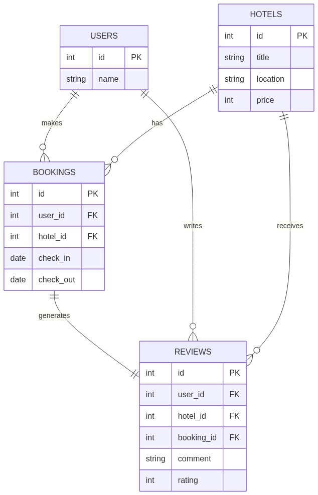

# Hotel Booking Database – SQLite

**A Relational Database Design Project | Harvard's CS50 SQL**

By Sadanand Mogaveera

**Video Overview:** https://youtu.be/dTj4jIla86Q

## Project Overview

This project focuses on designing a simplified hotel booking database using SQLite. It models the relationships between users, hotels, bookings, and reviews while demonstrating core relational database concepts such as entities, relationships, constraints, and query optimization.

The database is designed to represent a simplified real-world hotel booking system where users can browse hotels, make bookings, and leave reviews based on their experiences.

## Scope

The database for this project is designed for a simplified hotel booking system. It includes all entities necessary to allow users to browse hotels, make bookings, and leave reviews based on their experiences. The goal of this database is to model a real-world booking system while focusing on core relational database concepts such as entities, relationships, and constraints.

As such, included in the database's scope is:

- Users, including basic identifying information such as their name
- Hotels, including details such as title, location, and price
- Bookings, including the association between users and hotels along with check-in and check-out dates
- Reviews, including user feedback in the form of comments and ratings

Out of scope are elements such as payment processing, authentication systems, availability tracking, and administrative controls. These features are intentionally excluded to keep the project focused on database design fundamentals.

## Functional Requirements

This database will support:

- CRUD operations for users and hotels
- Creating bookings that link users with hotels
- Storing check-in and check-out dates for each booking
- Allowing users to leave reviews with ratings and comments
- Retrieving bookings and reviews using relational queries

Note that in this iteration, the system will not support authentication, payment systems, or real-time booking availability checks.

## Representation

Entities are captured in SQLite tables with the following schema.

### Entities

The database includes the following entities:

#### Users

The `users` table includes:

- `id`, which specifies the unique ID for each user as an `INTEGER`. This column has the `PRIMARY KEY` constraint applied.
- `name`, which specifies the user's name as `TEXT`. This column is required and thus has the `NOT NULL` constraint applied.

This design ensures that each user is uniquely identifiable while keeping the structure simple.

#### Hotels

The `hotels` table includes:

- `id`, which specifies the unique ID for each hotel as an `INTEGER`, with the `PRIMARY KEY` constraint applied.
- `title`, which specifies the hotel's name as `TEXT`.
- `location`, which specifies the hotel's location as `TEXT`.
- `price`, which specifies the hotel's price as an `INTEGER`.

All columns are required and have the `NOT NULL` constraint applied. This ensures that no incomplete hotel records can be stored.

#### Bookings

The `bookings` table includes:

- `id`, which specifies the unique ID for each booking as an `INTEGER`, with the `PRIMARY KEY` constraint applied.
- `user_id`, which specifies the ID of the user making the booking as an `INTEGER`. This column has a `FOREIGN KEY` constraint referencing `users(id)`.
- `hotel_id`, which specifies the ID of the hotel being booked as an `INTEGER`. This column has a `FOREIGN KEY` constraint referencing `hotels(id)`.
- `check_in`, which specifies the check-in date as `DATE`.
- `check_out`, which specifies the check-out date as `DATE`.

All columns are required and have the `NOT NULL` constraint applied. Additionally, a constraint ensures that the check-out date is always later than the check-in date, preventing invalid bookings.

#### Reviews

The `reviews` table includes:

- `id`, which specifies the unique ID for each review as an `INTEGER`, with the `PRIMARY KEY` constraint applied.
- `user_id`, which specifies the ID of the user who wrote the review as an `INTEGER`, with a `FOREIGN KEY` constraint referencing `users(id)`.
- `hotel_id`, which specifies the ID of the hotel being reviewed as an `INTEGER`, with a `FOREIGN KEY` constraint referencing `hotels(id)`.
- `booking_id`, which specifies the ID of the booking associated with the review as an `INTEGER`, with a `FOREIGN KEY` constraint referencing `bookings(id)`.
- `comment`, which stores the review content as `TEXT`.
- `rating`, which stores the rating as an `INTEGER`.

A constraint ensures that the rating value is between 1 and 5. All necessary columns are required to maintain consistency and data integrity.

### Relationships

The below entity relationship diagram describes the relationships among the entities in the database.

As detailed by the diagram:

- A user can make zero to many bookings, while each booking is associated with exactly one user.
- A hotel can have zero to many bookings, while each booking is associated with exactly one hotel.
- A booking can have at most one review, and each review is associated with exactly one booking.
- A user can write zero to many reviews, while each review is written by exactly one user.
- A hotel can receive zero to many reviews, while each review is associated with exactly one hotel.

These relationships are enforced using foreign key constraints, ensuring that all data remains consistent and properly linked.

## Optimizations

Per the typical queries in `queries.sql`, it is common for users of the database to retrieve bookings based on users or hotels. For that reason, indexes are created on the `user_id` and `hotel_id` columns in the bookings table to improve query performance.

Similarly, retrieving reviews for a particular hotel is a frequent operation. Therefore, an index is created on the `hotel_id` column in the reviews table to speed up these queries.

These optimizations help ensure that the database performs efficiently as the volume of data increases.

## Limitations

The current schema assumes a simplified booking system and has several limitations.

The database does not support authentication or user security, meaning that user identity is not verified. It also does not handle payment processing or financial transactions, which would be necessary in a real-world system.

Additionally, the database does not prevent
